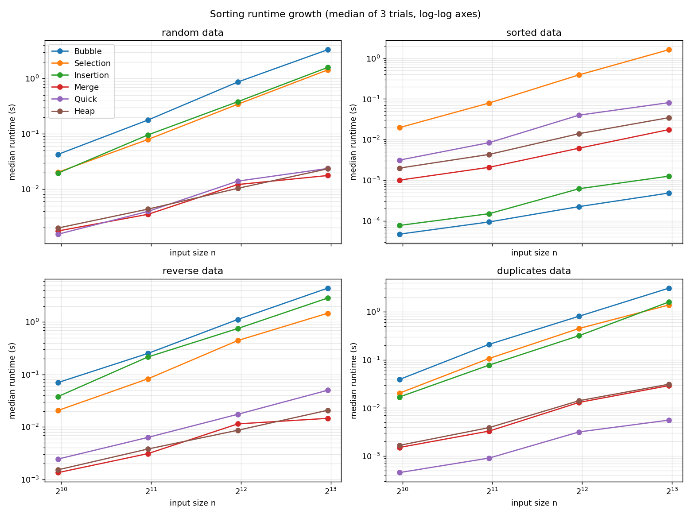

# Laboratory Activity No. 11 - Sorting Algorithms and Performance Benchmarks

CPEPRO8L - Data Structures and Algorithms, First Semester AY 2026-2027
Name: _<your name / section>_

## Objectives
1. Implement Bubble, Selection, Insertion, Merge, Quick and Heap Sort.
2. Verify correctness on normal, boundary, duplicate and reverse-order datasets.
3. Measure and compare runtime across input sizes and data distributions.
4. Relate the measurements to expected time and space complexity.

## Environment
- Python 3.12 (3.11+ required), standard library only for the sorts and tests
  (`random`, `time`, `statistics`, `gc`, `csv`); `matplotlib` is used only to draw the chart.
- Single-core Linux machine. Absolute times depend on hardware; ratios and counts are what matter.

## Files submitted
| File | Purpose |
| --- | --- |
| `sorting_algorithms.py` | Six implementations, with comparison/movement counters |
| `test_sorts.py` | 55 correctness tests (9 datasets x 6 algorithms + 1 extra check) |
| `benchmark_sorts.py` | Controlled benchmark; writes the CSVs and chart |
| `results_raw.csv` | Every individual trial (288 rows) |
| `results_summary.csv` | Median runtime, comparisons, movements per algorithm/condition/size |
| `runtime_chart.png` | Runtime growth chart |
| `README.md` | This report |

## Execution commands
```
python test_sorts.py          # must print OK before benchmarking
python benchmark_sorts.py     # regenerates results_raw.csv, results_summary.csv, runtime_chart.png
```

## Design notes (Tasks A-C)
- **Datasets:** empty, one item, two items, all-equal, duplicate-heavy, already sorted, reverse sorted,
  random, and negatives/zero. Verified against an independent reference (`sorted()`, used only in tests).
- **Counters:** *comparisons* = element-vs-element comparisons; *movements* = element writes
  (a swap counts as 2, an insertion shift as 1, a merge copy/write as 1).
- **Quick Sort pivot:** median of first/middle/last element, with three-way (Dutch-flag) partitioning,
  recursing on the smaller side and looping on the larger. This avoids the classic O(n^2) on sorted input
  and on many equal keys.
- **Extra storage:** Bubble/Selection/Insertion/Heap O(1); Quick O(log n) stack; Merge O(n) buffer.
  (Every function also copies its input, which is a constant overhead shared by all six.)
- **Fairness (Task D):** same seeded data for all algorithms; fresh copy before each trial; timer wraps
  only the sort call (`perf_counter`, GC disabled); 3 trials, median reported; results checked for
  correctness outside the timed region. Sizes: 1000, 2000, 4000, 8000. Skip rule: quadratic sorts would
  be skipped only if projected time exceeded 8 s per run - **no run was skipped** on this machine.

## Results: median runtime in milliseconds (3 trials)
**Random**
| Algorithm | 1000 | 2000 | 4000 | 8000 |
| --- | ---: | ---: | ---: | ---: |
| Bubble | 42.62 | 177.91 | 867.09 | 3327.34 |
| Selection | 20.25 | 79.22 | 343.20 | 1433.78 |
| Insertion | 19.52 | 95.66 | 382.07 | 1588.70 |
| Merge | 1.75 | 3.50 | 12.10 | 17.61 |
| Quick | 1.53 | 3.95 | 13.96 | 23.65 |
| Heap | 1.98 | 4.35 | 10.33 | 23.28 |

**Already sorted**
| Algorithm | 1000 | 2000 | 4000 | 8000 |
| --- | ---: | ---: | ---: | ---: |
| Bubble | 0.05 | 0.09 | 0.22 | 0.48 |
| Selection | 19.68 | 79.51 | 391.44 | 1629.14 |
| Insertion | 0.08 | 0.15 | 0.62 | 1.26 |
| Merge | 1.00 | 2.08 | 6.14 | 17.59 |
| Quick | 3.12 | 8.41 | 39.92 | 81.12 |
| Heap | 1.98 | 4.31 | 13.99 | 34.63 |

**Reverse sorted**
| Algorithm | 1000 | 2000 | 4000 | 8000 |
| --- | ---: | ---: | ---: | ---: |
| Bubble | 70.32 | 252.75 | 1121.14 | 4433.71 |
| Selection | 20.65 | 82.75 | 444.41 | 1472.68 |
| Insertion | 38.06 | 216.02 | 753.45 | 2869.40 |
| Merge | 1.35 | 3.10 | 11.42 | 14.58 |
| Quick | 2.44 | 6.32 | 17.43 | 50.03 |
| Heap | 1.52 | 3.79 | 8.64 | 20.76 |

**Duplicate-heavy (10 distinct values)**
| Algorithm | 1000 | 2000 | 4000 | 8000 |
| --- | ---: | ---: | ---: | ---: |
| Bubble | 39.11 | 211.00 | 808.80 | 3105.50 |
| Selection | 20.31 | 107.19 | 449.91 | 1385.82 |
| Insertion | 16.91 | 78.04 | 319.07 | 1601.22 |
| Merge | 1.51 | 3.31 | 13.04 | 29.15 |
| Quick | 0.45 | 0.91 | 3.17 | 5.59 |
| Heap | 1.67 | 3.91 | 14.16 | 31.18 |

**Operation counts at n = 8000** (comparisons / movements)
| Algorithm | Random | Sorted | Reverse | Duplicates |
| --- | ---: | ---: | ---: | ---: |
| Bubble | 31,990,747 / 32,033,882 | 7,999 / 0 | 31,996,000 / 63,992,000 | 31,667,545 / 29,050,580 |
| Selection | 31,996,000 / 15,978 | 31,996,000 / 0 | 31,996,000 / 8,000 | 31,996,000 / 14,444 |
| Insertion | 16,024,932 / 16,024,933 | 7,999 / 0 | 31,996,000 / 32,003,999 | 14,533,286 / 14,532,512 |
| Merge | 93,554 / 149,972 | 51,456 / 102,912 | 52,352 / 155,264 | 90,707 / 145,994 |
| Quick | 174,452 / 200,778 | 815,208 / 818,450 | 600,375 / 606,166 | 39,337 / 32,144 |
| Heap | 182,974 / 193,408 | 189,377 / 205,276 | 176,057 / 181,552 | 168,818 / 174,572 |



## Guide questions
**1. Which elementary algorithm benefited most from already sorted data, and why?**
Bubble Sort (with the early-exit flag) and Insertion Sort both collapse to O(n): 7,999 comparisons and zero
movements at n = 8000. Bubble improved most in measured time (3327 ms random -> 0.48 ms sorted) because one pass
with no swaps ends the algorithm. Insertion improved too (1589 ms -> 1.26 ms) because every element is
compared once and never shifted. Selection Sort did not benefit at all: it always makes about n^2/2
comparisons (31,996,000) since it must scan the whole unsorted part to be sure of the minimum.

**2. How did the Quick Sort pivot strategy affect sorted or duplicate-heavy data?**
Median-of-three prevented the O(n^2) collapse a first/last pivot would cause on sorted data (8 ms vs. seconds),
and three-way partitioning made duplicate-heavy data the *fastest* Quick Sort case (5.59 ms at n = 8000,
only 39,337 comparisons), since all keys equal to the pivot are removed from further recursion.
It was not free on sorted data, though: 815,208 comparisons vs. 174,452 on random, making Quick Sort the
slowest O(n log n) algorithm there (81 ms vs. 17.6 ms for Merge).

**3. Why is median runtime preferable to a single timing result?**
A single timing can be inflated by one-off OS scheduling, cache warm-up or garbage collection. The median ignores
such outliers and is more stable than the mean. Our own data shows noise: Merge Sort on random data went
12.10 ms -> 17.61 ms from n = 4000 to 8000 (1.5x), less than the ~2.1x expected, so single readings are unreliable.

**4. What memory trade-off does Merge Sort make compared with in-place alternatives?**
Merge Sort spends O(n) auxiliary memory (a buffer the size of the input) to get guaranteed O(n log n) time and
stability, whereas Heap Sort (and Quick Sort, apart from its O(log n) stack) sorts in place. In our runs Merge
made the fewest comparisons everywhere (93,554 random at n = 8000, vs. 182,974 for Heap), which is what the extra
memory buys.

**5. When might an O(n^2) algorithm still be reasonable?**
For small inputs (constant factors dominate; at n = 1000 Insertion took about 20 ms), for nearly sorted data
(Insertion/Bubble were the fastest sorts on sorted input: 1.26 ms and 0.48 ms at n = 8000), when memory is
extremely limited and simple code matters, or when writes are costly (Selection Sort performs only 15,978
movements on random data at n = 8000).

**6. Which measured result differed most from the theoretical expectation, and what likely caused it?**
Quick Sort on already sorted data. Theory says O(n log n) on average, and the median-of-three pivot should make
sorted input a good case, yet it was ~4.6x slower than Merge Sort and used ~4.7x more comparisons than on random
data. My likely explanation (not separately verified): after the first three-way partition the elements are
rearranged, and median-of-three on those rearranged sub-ranges produces uneven splits, adding recursion work.
Secondary effects: Python's per-operation overhead, and noise on a single-core machine.
A smaller deviation was Merge Sort's non-doubling runtime between n = 4000 and 8000 (see Q3).

## Conclusion
All six algorithms passed the full correctness suite and every benchmark result was verified against a
reference. The quadratic sorts grew ~4x per doubling of n (e.g., Bubble on random: 178 -> 867 -> 3327 ms), while
Merge, Quick and Heap grew close to 2x, as expected from O(n^2) vs. O(n log n). Input distribution mattered a
lot: Bubble and Insertion won on sorted data, Quick Sort with three-way partitioning won on duplicate-heavy
data, and Merge/Heap were the most consistent across conditions.
