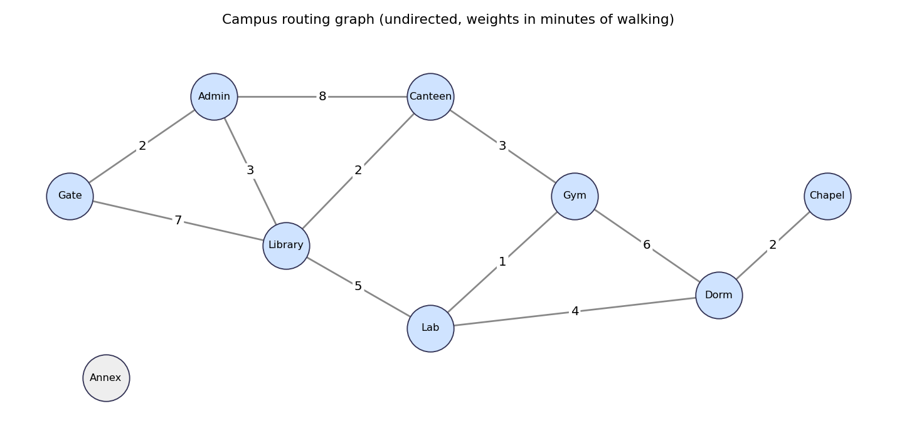

# Laboratory Activity No. 12 - Graph Traversals and Shortest-Path Routing

CPEPRO8L - Data Structures and Algorithms, First Semester AY 2026-2027
Name: _<your name / section>_

> **Note on the dataset:** the instructor's assigned graph was not included with the lab sheet, so a
> sample 9-vertex campus-routing graph is encoded in `campus_edges.csv`. To use the assigned graph, replace
> that file (columns `u,v,weight`; an empty `v` declares an isolated vertex), set the BFS/DFS start vertices and
> Dijkstra source at the top of `run_demo.py`, update the expected values in `test_graph.py`, and rerun.

## Objectives
1. Represent unweighted and weighted graphs with adjacency lists.
2. Implement and trace BFS and DFS.
3. Implement Dijkstra's algorithm with a priority queue (`heapq`).
4. Verify results with hand traces and independent test cases.

## Environment
Python 3.11+ (developed on 3.12). Standard library only for the algorithms (`collections`, `heapq`, `math`,
`csv`, `unittest`); `matplotlib` is used only by `run_demo.py` to draw the diagram.

## Execution commands
```
python test_graph.py --report   # runs 34 tests, writes test_report.md
python run_demo.py              # regenerates edge_table.md, campus_graph.png, hand_traces.md, routing_results.md
```

## Files submitted
| File | Purpose |
| --- | --- |
| `graph.py` | Adjacency-list `Graph` (directed/undirected, weighted/unweighted), CSV loader, verification |
| `traversals.py` | BFS (queue), DFS (explicit stack), recursive DFS cross-check, path rebuild |
| `dijkstra.py` | Heap-based Dijkstra, predecessor tracking, path reconstruction, negative-weight rejection |
| `test_graph.py` | 34 automated tests with expected/observed table |
| `run_demo.py` | Generates the evidence files below |
| `campus_edges.csv` | Source dataset |
| `edge_table.md`, `campus_graph.png` | Edge table and labeled diagram |
| `hand_traces.md` | Step-by-step queue/stack traces (BFS and DFS, two start vertices) |
| `routing_results.md` | Dijkstra trace, routing table, BFS-vs-Dijkstra comparison, rejected negative case |
| `test_report.md` | Expected vs observed table (also reproduced below) |
| `README.md` | This report |

## Design decisions
- **Neighbour ordering rule:** ascending alphabetical order of vertex labels, applied everywhere, so BFS, DFS and
  Dijkstra are deterministic.
- **BFS** marks vertices visited when enqueued. **DFS** uses an explicit stack, marks vertices visited when popped
  and pushes neighbours in reverse order, giving the same order as recursive DFS (tested).
- **Dijkstra** uses a lazy-deletion heap of `(distance, label, vertex)`; stale entries are skipped; relaxation uses
  strict `<`, so with equal-cost alternatives the first-found route is kept. Negative weights raise `ValueError`.
  `Graph` itself can store negative weights (so the rejection happens in Dijkstra, as the lab specifies).
- **Validation:** `Graph.verify_against` confirms every source vertex and edge appears in the structure.

## Graph (Task A)
| # | Edge | Weight |
| ---: | --- | ---: |
| 1 | Admin -- Canteen | 8 |
| 2 | Admin -- Gate | 2 |
| 3 | Admin -- Library | 3 |
| 4 | Canteen -- Gym | 3 |
| 5 | Canteen -- Library | 2 |
| 6 | Chapel -- Dorm | 2 |
| 7 | Dorm -- Gym | 6 |
| 8 | Dorm -- Lab | 4 |
| 9 | Gate -- Library | 7 |
| 10 | Gym -- Lab | 1 |
| 11 | Lab -- Library | 5 |

Isolated vertices (no edges): Annex




## Traversal results (Task B) - full step-by-step traces in `hand_traces.md`
| Start | BFS order | DFS order |
| --- | --- | --- |
| Gate | Gate, Admin, Library, Canteen, Lab, Gym, Dorm, Chapel | Gate, Admin, Canteen, Gym, Dorm, Chapel, Lab, Library |
| Chapel | Chapel, Dorm, Gym, Lab, Canteen, Library, Admin, Gate | Chapel, Dorm, Gym, Canteen, Admin, Gate, Library, Lab |

Annex (isolated) is never reached. The expected orders in the tests were worked out by hand
before being compared with program output; they matched.

## Shortest paths from Gate (Task C) - details in `routing_results.md`
| Target | Distance | Shortest path | Hand check |
| --- | ---: | --- | --- |
| Admin | 2 | Gate → Admin | 2 |
| Library | 5 | Gate → Admin → Library | 2 + 3 |
| Canteen | 7 | Gate → Admin → Library → Canteen | 2 + 3 + 2 |
| Lab | 10 | Gate → Admin → Library → Lab | 2 + 3 + 5 |
| Gym | 10 | Gate → Admin → Library → Canteen → Gym | 2 + 3 + 2 + 3 |
| Dorm | 14 | Gate → Admin → Library → Lab → Dorm | 2 + 3 + 5 + 4 |
| Chapel | 16 | Gate → Admin → Library → Lab → Dorm → Chapel | 2 + 3 + 5 + 4 + 2 |
| Annex | unreachable | no path | - |

**Rejected case:** a directed graph with edges A→B (4), B→C (−3), A→C (2) is rejected with
`ValueError: Dijkstra's algorithm requires nonnegative edge weights`.

## BFS tree vs shortest-path tree (Task D)
The trees differ at **Library** (BFS parent Gate, 1 hop, cost 7; Dijkstra parent Admin, 2 hops, cost 5) and
**Canteen** (BFS parent Admin, cost 10; Dijkstra parent Library, cost 7). All other parents agree. Example: the BFS
route to Gym (Gate→Admin→Canteen→Gym) has 3 edges but costs 13, while the cheapest route costs 10 using 4 edges.

## Expected vs observed tests
| ID | Test | Expected | Observed | Status |
| --- | --- | --- | --- | --- |
| G1 | Campus graph: vertex count | `9` | `9` | PASS |
| G2 | Campus graph: undirected edge count | `11` | `11` | PASS |
| G3 | Every source vertex/edge present in structure | `[]` | `[]` | PASS |
| G4 | Undirected edge stored both ways (Gate-Admin = 2) | `(2, 2)` | `(2, 2)` | PASS |
| G5 | Directed edge stored one way only | `([('B', 1)], [])` | `([('B', 1)], [])` | PASS |
| G6 | Duplicate edge rejected | `ValueError` | `ValueError` | PASS |
| G7 | Non-numeric weight rejected | `ValueError` | `ValueError` | PASS |
| B1 | BFS from Gate | `['Gate', 'Admin', 'Library', 'Canteen', 'Lab', 'Gym', 'Dorm', 'Chapel']` | `['Gate', 'Admin', 'Library', 'Canteen', 'Lab', 'Gym', 'Dorm', 'Chapel']` | PASS |
| B2 | BFS from Chapel | `['Chapel', 'Dorm', 'Gym', 'Lab', 'Canteen', 'Library', 'Admin', 'Gate']` | `['Chapel', 'Dorm', 'Gym', 'Lab', 'Canteen', 'Library', 'Admin', 'Gate']` | PASS |
| D1 | DFS from Gate | `['Gate', 'Admin', 'Canteen', 'Gym', 'Dorm', 'Chapel', 'Lab', 'Library']` | `['Gate', 'Admin', 'Canteen', 'Gym', 'Dorm', 'Chapel', 'Lab', 'Library']` | PASS |
| D2 | DFS from Chapel | `['Chapel', 'Dorm', 'Gym', 'Canteen', 'Admin', 'Gate', 'Library', 'Lab']` | `['Chapel', 'Dorm', 'Gym', 'Canteen', 'Admin', 'Gate', 'Library', 'Lab']` | PASS |
| D3 | Stack DFS equals recursive DFS (both starts) | `True` | `True` | PASS |
| D4 | BFS/DFS never reach isolated vertex Annex | `(False, False)` | `(False, False)` | PASS |
| X1 | Isolated vertex as start: traversal is just itself | `['Annex']` | `['Annex']` | PASS |
| X2 | Cycle (triangle): BFS visits each vertex once | `['A', 'B', 'C']` | `['A', 'B', 'C']` | PASS |
| X3 | Cycle (triangle): DFS terminates, visits each once | `['A', 'B', 'C']` | `['A', 'B', 'C']` | PASS |
| X4 | Unknown start vertex rejected | `KeyError` | `KeyError` | PASS |
| H1 | BFS minimises edges: Gate->Library is 1 hop | `1` | `1` | PASS |
| S1 | Dijkstra distances from Gate | `{'Admin': 2, 'Library': 5, 'Canteen': 7, 'Lab': 10, 'Gym': 10, 'Dorm': 14, 'Chapel': 16, 'Annex': inf}` | `{'Admin': 2, 'Annex': inf, 'Canteen': 7, 'Chapel': 16, 'Dorm': 14, 'Gym': 10, 'Lab': 10, 'Library': 5}` | PASS |
| S2 | Path Gate->Chapel | `['Gate', 'Admin', 'Library', 'Lab', 'Dorm', 'Chapel']` | `['Gate', 'Admin', 'Library', 'Lab', 'Dorm', 'Chapel']` | PASS |
| S3 | Path Gate->Gym | `['Gate', 'Admin', 'Library', 'Canteen', 'Gym']` | `['Gate', 'Admin', 'Library', 'Canteen', 'Gym']` | PASS |
| S4 | Hand sum of Gate->Chapel path (2+3+5+4+2) | `16` | `16` | PASS |
| S5 | Hand sum of Gate->Gym path (2+3+2+3) | `10` | `10` | PASS |
| S6 | Unreachable target Annex: no path, distance inf | `(None, inf)` | `(None, inf)` | PASS |
| S7 | Source = target: zero-cost one-vertex path | `(['Gate'], 0)` | `(['Gate'], 0)` | PASS |
| S8 | Equal-cost alternatives: both routes cost 2, A-route kept deterministically | `(2, ['S', 'A', 'T'])` | `(2, ['S', 'A', 'T'])` | PASS |
| S9 | Cycle graph: shortest A->C is the direct edge | `(1, ['A', 'C'])` | `(1, ['A', 'C'])` | PASS |
| S10 | Directed graph: B cannot reach A | `inf` | `inf` | PASS |
| S11 | Zero-weight edge allowed | `0` | `0` | PASS |
| N1 | Negative weight is storable in Graph | `True` | `True` | PASS |
| N2 | Dijkstra rejects negative weight | `ValueError` | `ValueError` | PASS |
| N3 | Dijkstra rejects unknown source | `KeyError` | `KeyError` | PASS |
| C1 | BFS tree vs Dijkstra tree differ at exactly these vertices | `['Canteen', 'Library']` | `['Canteen', 'Library']` | PASS |
| C2 | BFS path to Gym is NOT the cheapest (cost 13 vs 10) | `(13, 10)` | `(13, 10)` | PASS |

**34 / 34 passed**

## Complexity (adjacency-list representation; V vertices, E edges)
| Algorithm | Time | Space (besides the graph) |
| --- | --- | --- |
| BFS | O(V + E) | O(V): queue, visited set, parent map |
| DFS (stack or recursive) | O(V + E) | O(V): visited set + stack (stack may briefly hold duplicates, at most O(E)) |
| Dijkstra with binary heap | O((V + E) log V), i.e. O(E log V) when E ≥ V | O(V + E): distances, predecessors, heap with lazy deletion |

**Which algorithm to use:** BFS or DFS for unweighted *reachability*; BFS for *minimum-edge* paths in unweighted
graphs; Dijkstra for *weighted* routing with nonnegative weights.

## Guide questions
**1. How does the queue make BFS different from DFS stack behaviour?**
A queue is first-in-first-out, so BFS finishes every vertex at distance k edges before any at k+1, spreading outward
in layers. A stack is last-in-first-out, so DFS follows the most recently discovered vertex and goes as deep as
possible before backtracking. From Gate, BFS visits Admin and Library first; DFS goes Admin → Canteen → Gym → Dorm → Chapel
before returning to Lab and Library.

**2. Why must neighbour order be defined before comparing traversal results?**
Many valid BFS/DFS orders exist for the same graph; which one you get depends on the order neighbours are examined.
Without a fixed rule (here: alphabetical), a hand trace and a program could both be correct yet differ, and results
could not be compared or tested reproducibly.

**3. Under what condition can BFS produce a shortest path, and what does it minimise?**
When all edges have the same cost (an unweighted graph, or all weights equal). It then minimises the *number of edges*.
On our weighted graph the BFS route Gate→Gym costs 13 versus the true minimum of 10.

**4. Why is Dijkstra invalid for graphs with negative edge weights?**
Dijkstra finalises the vertex with the smallest tentative distance, assuming any other route to it can only be longer
because weights never reduce a path's cost. A negative edge breaks that: in A→B (4), B→C (−3), A→C (2), C is
finalised at 2 but A→B→C costs 1. (With negative cycles no shortest path exists at all.) Bellman-Ford handles negative weights.

**5. What is the benefit of storing predecessor information with distances?**
Distances alone give only the cost. Predecessors let us rebuild the actual route by walking back from the target, give a
whole shortest-path tree from one run, and allow independent verification by summing edge weights along the path.

**6. How do adjacency lists affect the complexity of BFS, DFS and Dijkstra?**
Each vertex's neighbours are listed directly, so every edge is examined a constant number of times (twice in an undirected
graph) and the traversals run in O(V + E). An adjacency matrix would need O(V) per vertex to scan a row, giving O(V²), which
is wasteful on sparse graphs like this one. For Dijkstra, the lists plus a heap give O((V + E) log V).

**7. Which test case gave the strongest evidence that the routing implementation is correct?**
Tests S2/S4 and S3/S5 together with C2: the program's Gate→Chapel and Gate→Gym routes were checked against hand sums of edge
weights (16 and 10), and C1/C2 show Dijkstra finds cheaper routes than the BFS tree where the two differ (e.g., 10 vs 13
for Gym). The equal-cost diamond (S8), the unreachable Annex (S6) and the negative-weight rejection (N2) cover the edge cases.

## Conclusion
BFS, DFS and Dijkstra all produced the expected, hand-verified results on the campus graph, and all 34 tests passed,
including an isolated vertex, a cycle, equal-cost alternatives, an unreachable target and invalid inputs. The comparison
showed that fewest-hops and lowest-cost routes can differ, so weighted routing needs Dijkstra rather than BFS.
